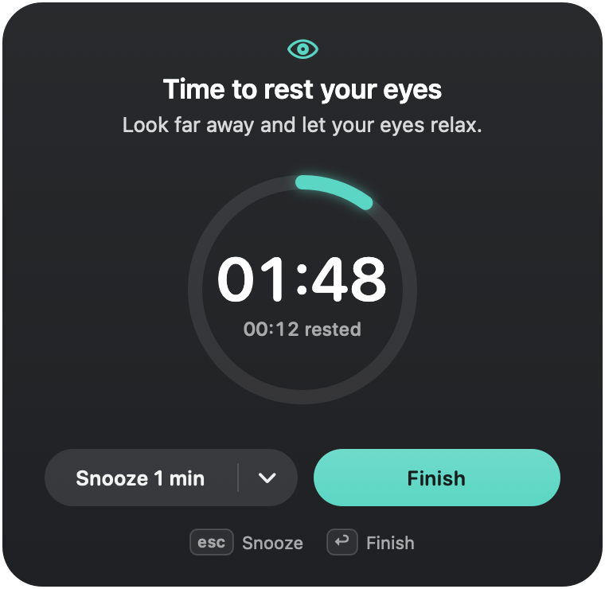
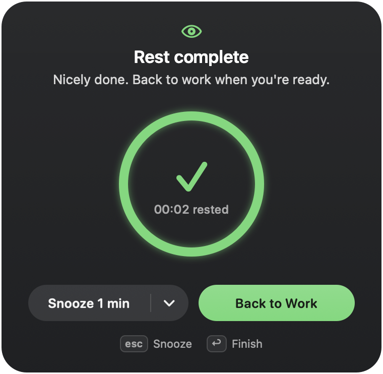
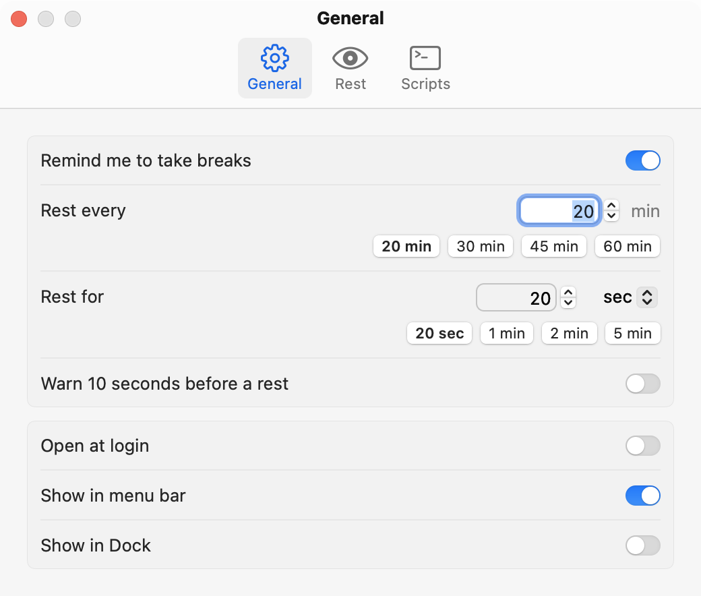
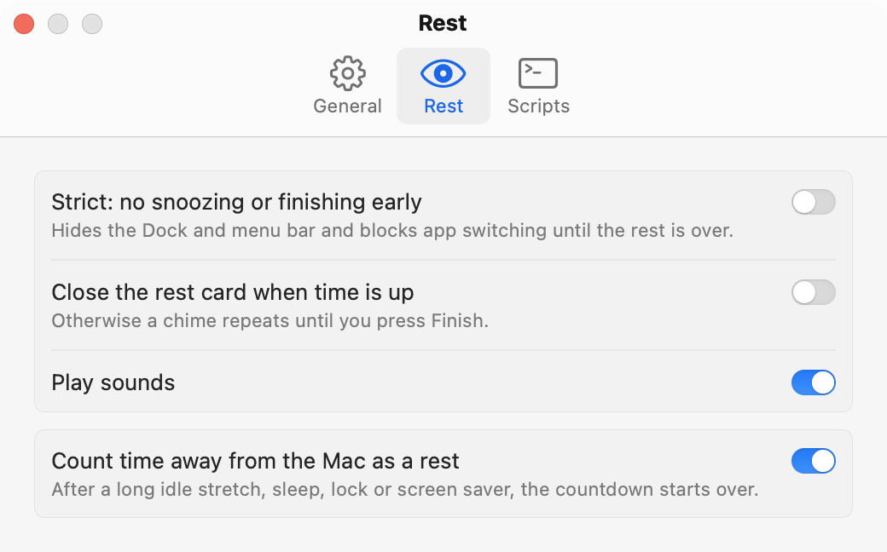

# Softfocus

A menu-bar app for macOS 14+ (Apple Silicon and Intel) that reminds you to rest your eyes. After each work period it dims every display and shows a rest card with a countdown. You can snooze or finish the rest, or, in strict mode, wait it out.

<p align="center">
  
  &nbsp;
  
</p>

## Install

Download `Softfocus.zip` from [Releases](../../releases), unzip it and move `Softfocus.app` to `/Applications`.

The app isn't notarized, so macOS blocks the first launch with *"Softfocus" Not Opened*. Click **Done**, then run:

```sh
xattr -dr com.apple.quarantine /Applications/Softfocus.app
```

Or open it once, then click **Open Anyway** in *System Settings › Privacy & Security*. On macOS 15 and later, right-click › Open no longer works.

## How it works

**Heads-up.** A few seconds before a rest, a small panel lets you snooze or start the rest early.

<p align="center"></p>

**Rest card.** Every display dims. The card shows a progress ring with the time left. When the rest is done, the ring turns green and **Finish** becomes **Back to Work**.

| Key | Action |
|---|---|
| Esc | Snooze 1 min |
| ⇧Esc | Snooze 5 min |
| Return / Space | Finish |

Keys are ignored for the first 0.5 s, so you can't dismiss the card by accident. The snooze chevron also offers 5 and 15 minutes.

**Menu-bar icon.** The ring fills as work time passes. A solid dot means resting, a slashed ring means reminders are off, and a dashed ring means you're away.

## Settings

<p align="center">
  
  &nbsp;
  
</p>

- **General:** how often and how long to rest, the heads-up, open at login, and the Dock and menu-bar icons. Type a duration exactly, use the stepper, or pick a preset. A value out of range is clamped, and a note shows the allowed range.
- **Rest:**
  - **Strict mode:** no snoozing or finishing early. The Dock, menu bar, app switching and Force Quit are blocked, and Quit is refused. Logout, restart and shutdown always go through. Settings, links and scripts can't turn off, loosen or shorten a strict rest.
  - **Auto-finish:** close the card when the time is up. Otherwise a chime repeats until you press Finish.
  - **Sounds.**
  - **Smart reset:** count time away from the Mac as a rest. See below.
- **Scripts:** run a shell script, executable, AppleScript or Automator workflow when a rest starts or ends.

If you hide both the Dock and menu-bar icons, opening the app again shows Settings.

### Smart reset

With *Count time away from the Mac as a rest* on:

- **You step away while working.** If there's no input for the rest length plus about a minute per 15 minutes of work, or the Mac sleeps, locks or starts the screen saver, the countdown pauses. A full work period starts at your first input or unlock.
- **A rest falls due while you're idle:**
  - Idle for at least a minute, and at least the rest length: no card appears for an empty desk.
  - Idle for 15 s or more, but less than that: the idle time counts, and the card starts part-way through, always leaving at least 10 s.
- **You lock the screen during a rest.** The rest keeps running, strict or not. If it runs out while you're away, the card closes quietly and work restarts when you're back.
- **You don't come back after a rest ends.** The chime stops after about 30 s, and later the card closes quietly.
- **A video or slideshow keeps the display awake.** That counts as using the Mac, so breaks still come.

With the setting off, idle time, lock and sleep are ignored.

### Open at login

This uses `SMAppService.mainApp`, and macOS has the final say. The toggle re-reads the system state at launch, on activation and when Settings opens. If macOS needs your approval, Settings says so and offers **Open Login Items…**. If registration fails, Settings shows the error and turns the toggle back off.

## Automation

AppleScript:

```applescript
tell application "Softfocus" to rest now
```

URL scheme: `softfocus://rest-now`, `finish`, `snooze?minutes=5`, `enable`, `disable`, `toggle`, `restart`, `settings`.

```sh
open "softfocus://snooze?minutes=5"
```

## Development

### Build

```sh
scripts/build-app.sh                 # release, universal → build/Softfocus.app (ad-hoc signed)
CONFIG=debug ARCHS=arm64 scripts/build-app.sh
SIGN_IDENTITY="Developer ID Application: …" scripts/build-app.sh
```

Requires Xcode 16+ / Swift 6. No third-party dependencies.

### Layout

| Target | What it holds |
|---|---|
| `SoftfocusCore` | Pure logic, no AppKit. Contains the `Cycle` state machine (events in, effects out, time passed in explicitly), settings and limits, display text, key rules, URL commands, presence tracking, and the test-control protocol. |
| `SoftfocusApp` | AppKit and SwiftUI. Contains `AppCoordinator`, which applies the cycle's effects, plus the rest overlay, heads-up panel, status item, Settings window, and system services (idle, presence, focus lock, chimes, hooks, login item), each behind a protocol. |
| `Softfocus` | `main.swift`, which only starts the app. |

Everything the app decides goes through `Cycle.handle(_:at:) -> [Effect]`. The coordinator only turns effects into windows, sounds and processes, so all the rules can be tested without a screen.

### Test

```sh
swift test --skip SoftfocusE2ETests  # unit + in-process view tests, < 1 s
scripts/test-e2e.sh                  # builds the app, then drives it end to end (~40 s)
```

> The end-to-end tests briefly dim your screens and show rest cards. Don't type while they run.

- **`SoftfocusCoreTests`** run the cycle with a fake clock: scheduling, heads-up, snooze, strict mode, auto-finish, idle and presence, settings changes, formatting, keys, URL parsing, and the control socket.
- **`SoftfocusAppTests`** build the real AppKit views in-process: card rendering, disabled buttons in strict mode, the snooze menu, and the menu-bar icon.
- **`SoftfocusE2ETests`** launch the built `Softfocus.app` as a separate process and drive it the way a user would. They operate the Settings window through its real controls via the macOS accessibility API, including fields, steppers, presets, toggles and tabs. That needs your terminal allowed under *Privacy & Security › Accessibility*. Without it, those tests are skipped with a message saying so. Each run uses its own defaults domain and is cleaned up afterwards. The tests check:
  - the windows the app really puts on screen (levels, frames, key focus, and the window server's own window list)
  - that hook scripts actually ran
  - that settings persist across a relaunch
  - Dock and menu-bar visibility, the URL commands, and quitting
  - that Settings opened from the menu-bar menu comes to the front on the first click, even with another app in front
  - open-at-login: registering, approval needed, errors, and changes made in System Settings

Renders of the rest card and each Settings tab are saved to `build/e2e-artifacts/`, and `swift test` writes card previews to `build/previews/`. The screenshots in this README come from those two folders.

`SOFTFOCUS_E2E_REAL_LOGIN=1 scripts/test-e2e.sh --filter openAtLoginWithRealMacOS` also registers the built app with macOS for real and then removes it. macOS shows a "login item added" notification.

### Test mode

When the app is started with `SOFTFOCUS_TESTING=1`, it:

- allows short durations and uses silent chimes;
- uses the defaults domain given in `SOFTFOCUS_DEFAULTS_SUITE`;
- uses a fake login item unless `SOFTFOCUS_REAL_LOGIN_ITEM=1`. `SOFTFOCUS_FAKE_LOGIN=requiresApproval|fail` picks how it answers;
- opens a JSON control socket at `SOFTFOCUS_CONTROL_SOCKET`. Over the socket, a test can read the state and a UI snapshot, press controls, send keys, inject idle or presence changes, change settings, render the card, or open URLs.

`SOFTFOCUS_FAKE_IDLE` fixes the idle reading, so the tests don't depend on someone touching the Mac. Without these variables, the socket is never opened.

## License

MIT. See [LICENSE](LICENSE).
